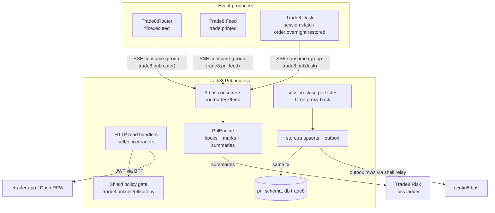

# Trade8:Pnl - Day P&L Service

> Audience: anyone evaluating or onboarding to the service. For the
> wire-level construction read `DESIGN.md`; for business functionality read
> `BUSINESS.md`. Vertical context: the top-level `DESIGN.md`

> (system map) and `BUSINESS.md` (business view).

## 1. Summary

Trade8:Pnl is the day profit-and-loss engine. It is a pure bus consumer: it
rebuilds positions and P&L deterministically from fill events
(`trade8:router:fill:executed`) and opening balances, maintains per-trader
and per-office summaries in real time, carries overnight positions across
sessions, and publishes summary events consumed by Trade8:Risk (loss ladder)
and the trader app (P&L widgets). Pnl owns no order state - it owns *derived*
financial state only, and everything it computes is replayable from the event
log plus opening balances.

## 2. Motivation

Profit-and-loss for a trading desk has one governing constraint: **it must
never disagree with the fills.** The classic failure is dual-write - an
order-state component tracking positions in parallel with the execution
stream, drifting under crash/restart. Pnl eliminates the hazard
architecturally:

- **Derived-only state.** Positions, realized/unrealized, fees, summaries and
  LFT are pure folds over (fill events + opening balances). Replay any day's
  event log and you get the same numbers to the penny.
- **Real-time trader feedback.** The trader's board must tick with every fill
  and every mark without a page refresh - a consumer-engine plus SSE surface,
  not reconciliation jobs.
- **Cross-session continuity.** Overnight positions and carried cost basis
  must survive session boundaries with explicit reconciliation against Desk's
  overnight snapshot, surfacing mismatches to operations instead of
  silently compounding them.

## 3. Architecture & High-Level Design

Fills apply to per-(trader, symbol) books; marks (prints) refresh unrealized
and the high-water trackers; session close persists everything and opens the
next session's balances.

## 4. Key Traits and Data Structures

- **`PnlState`** - shell core + shared `PnlEngine` + fan-out channel.
- **`PnlEngine`** (`core.rs`) - `books: RwLock<HashMap<(usr, symbol), PositionBook>>`,
  `marks`, `summaries`, `office_of`, the trading date, and the applied-fill
  dedupe set; the pure APIs `apply_fill_context_dedup`, `mark`,
  `summary`, `office_summary`, `resume_for`, `position(s)_…`.
- **`PositionBook`** - one (trader, symbol) state machine: signed size,
  average cost, realized, fees, last mark, max-net high-water, LFT low-water
  (max drawdown from the high-water); `apply_fill` handles opening/adding,
  reducing, closing and reversing fills.
- **`store`** - idempotent upserts (`position_snapshot`, `symbol_resume`,
  `trader_summary`, `office_summary`, opening balances, mismatch rows) +
  `insert_outbox_event` in the same tx.
- **`consumers`** - three `run_consumer` loops (router/desk/feed families);
  fills dedupe on transaction id so at-least-once redelivery converges.
- **Contracts** - `trade8::contracts::pnl.{Position, SymbolResume,
  TraderPnlSummary, OfficePnlSummary, OpeningBalance, OvernightVerification}`.

## 5. Rationale, Trade-offs, and Alternatives

- **Pure consumer, no order state.** Pnl projects fills; it never mutates
  orders. Rejected: owning a shadow order book (the dual-write hazard that
  motivated this design).
- **In-memory engine + idempotent persistence.** The engine is the real-time
  surface; the DB is the durable projection, written through with the same
  idempotency keys the bus dedupe uses. Rejected: DB-only accumulation (read
  on every mark), event-sourcing-only reads (no live board).
- **Last-print marks by default.** Unrealized derives from the last trade
  print (config could later switch quote-based marks per symbol class);
  eventual marks are business-acceptable - summaries note the mark source.
  Rejected: per-symbol mark jobs (another moving part).
- **Fee conversion at accumulation time** using `desk.currency.rate_to_usd`
  (×10⁴ fees converted once into the ×10⁴ money scale). Rejected: retaining
  per-currency balances and converting at read time (read-path drift).
- **Mimalloc allocator** (master design §11) for the fill-processing hot path.

## 6. Internal Implementation & Invariants (Private Design)

**Invariants** (unit + `tests/sql_matrix.rs`):

- A fill with a transaction id is applied **at most once** per process
  (dedupe set), and persisted upserts are idempotent - redelivery converges.
- High-water tracking is monotonic: `max_net` never decreases within a
  trading day even when net dips (an adverse mark after a peak still counts
  toward LFT).
- `LFT = max(0, max_net_day − current net)` - recomputed at every fill and
  mark; per-symbol resumes fold into the trader summary.
- Marks refresh the affected books **and** the owning traders' summaries -
  a stale summary on a mark move is not representable.
- Session close persists positions, per-symbol resumes, trader and office
  summaries, and next-day opening balances in one tx; the Cron proxy-back
  endpoint runs the identical persist pass.
- Overnight restored events reconcile realized carry against the parked
  `pnl_carry`; a divergence persists a mismatch event (never silent).
- Money is ×10⁴-scaled; price fields are instrument-scale ticks; fee
  conversion applies `rate_to_usd/10⁴` per fee currency.
- All persistence runs on a `begin()` tx after `set_tenant_context`
  (transaction-local RLS context).

## 7. Unresolved Questions / Future Designs

- **Order→symbol resolution on the fill path** - router fills carry
  usr/symbol/price; the engine's `symbol_for_order` hook is a stub, and the
  consumer resolves from the event payload - a payload-schema tightening is
  planned rather than an internal lookup.
- **Quote-based marks** - per-symbol-class mark source config (print vs BBO)
  is deferred until a class actually needs it.
- **`trade8:pnl:overnight:verification`** - the verification contract type
  exists; the mismatch event is emitted but full reconciliation UX (ops
  queue with adjust/replay actions) is an open admin design.
- **Replay-from-bus tooling** - rebuilding today's engine from archived
  events relies on bus retention; whether Pnl should self-replay from a
  Storage-cold journal is an open platform question.

---

**Architecture & Design:** trade8:pnl and its underlying concepts were designed by [Hamid Jahanzad](https://www.linkedin.com/in/hamidjahanzad/).
